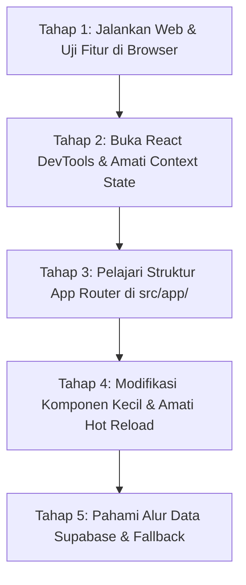

# 📘 Panduan Lengkap, Rangkuman Kode & Cara Belajar Cepat Modesy Web

Dokumen ini dibuat khusus sebagai panduan komprehensif untuk memahami seluruh arsitektur, cara kerja kode (*code explanation*), serta metode tercepat untuk mempelajari dan memodifikasi aplikasi **Modesy Multi-Vendor Marketplace Clone** ini langsung melalui browser dan editor kode Anda.

---

## 📑 Daftar Isi
1. [Rangkuman Arsitektur & Teknologi Web](#1-rangkuman-arsitektur--teknologi-web)
2. [Penjelasan Kode Modul Utama (Core Systems)](#2-penjelasan-kode-modul-utama-core-systems)
   - [A. Sistem Autentikasi & Multi-Role (`AuthContext`)](#a-sistem-autentikasi--multi-role-authcontext)
   - [B. Sistem Pengubah Bahasa & Dukungan RTL Arab (`LanguageContext`)](#b-sistem-pengubah-bahasa--dukungan-rtl-arab-languagecontext)
   - [C. Sistem Multi-Mata Uang (`CurrencyContext`)](#c-sistem-multi-mata-uang-currencycontext)
   - [D. Sistem Keranjang Belanja Berbasis Role (`CartContext`)](#d-sistem-keranjang-belanja-berbasis-role-cartcontext)
   - [E. Sistem Alur Checkout Bertahap (`CheckoutPageView`)](#e-sistem-alur-checkout-bertahap-checkoutpageview)
   - [F. Pipeline Produk & Supabase Database (`CategoryPageView`)](#f-pipeline-produk--supabase-database-categorypageview)
3. [Contoh Kode & Hasil Tampilannya di Web (Code vs Result)](#3-contoh-kode--hasil-tampilannya-di-web-code-vs-result)
   - [Contoh 1: Alur Checkout 2 Langkah & Ringkasan Pajak](#contoh-1-alur-checkout-2-langkah--ringkasan-pajak)
   - [Contoh 2: Perubahan Bahasa ke Arab & Arah Teks RTL](#contoh-2-perubahan-bahasa-ke-arab--arah-teks-rtl)
   - [Contoh 3: Konversi Harga Otomatis Berdasarkan Mata Uang](#contoh-3-konversi-harga-otomatis-berdasarkan-mata-uang)
   - [Contoh 4: Multi-Role Login & Menu Dropdown Header](#contoh-4-multi-role-login--menu-dropdown-header)
4. [Cara Belajar Cepat Melalui Web (Fast-Track Roadmap)](#4-cara-belajar-cepat-melalui-web-fast-track-roadmap)
5. [Cheat Sheet: Daftar File Penting untuk Modifikasi Cepat](#5-cheat-sheet-daftar-file-penting-untuk-modifikasi-cepat)

---

## 1. Rangkuman Arsitektur & Teknologi Web

Aplikasi web ini dibangun dengan arsitektur modern berbasis **Next.js 15 (App Router)** yang menggabungkan kecepatan SSR (*Server-Side Rendering*) dengan interaktivitas Client-Side React.

### Stack Teknologi Utama:
- **Framework**: [Next.js 15](https://nextjs.org/) dengan App Router (`src/app/`).
- **Library UI**: [React 19](https://react.dev/) + [TypeScript](https://www.typescriptlang.org/) untuk *strict type-safety*.
- **Styling**: [Tailwind CSS](https://tailwindcss.com/) dengan palet warna resmi Modesy (Warna aksen utama: Toska `#00a99d`, Abu gelap `#222222`, PayPal Gold `#ffc439`).
- **Icons**: [Lucide React](https://lucide.dev/) (ikon responsif dan ringan).
- **Backend & Database**: [Supabase](https://supabase.com/) (PostgreSQL, Supabase Auth, Table `products`, `profiles`, `product_images`, `orders`).
- **State Management**: React Context API modular (`AuthContext`, `LanguageContext`, `CurrencyContext`, `CartContext`, `WishlistContext`).

### Peta Alur Arsitektur Sistem:
```text
                       +---------------------------------------+
                       |              RootLayout               |
                       | (Language > Currency > Auth > Cart)   |
                       +-------------------+-------------------+
                                           |
         +---------------------------------+---------------------------------+
         |                                 |                                 |
         v                                 v                                 v
+-----------------+               +-----------------+               +-----------------+
|   Area Publik   |               | Halaman Belanja |               |  Area Dashboard |
| - Landing (/)   |               | - /category/[s] |               | - /admin        |
| - /blog         |               | - /product/[id] |               | - /vendor       |
| - /contact      |               | - /cart         |               | - /member       |
| - /shops        |               | - /checkout     |               | - /moderator    |
+-----------------+               +-----------------+               +-----------------+
```

---

## 2. Penjelasan Kode Modul Utama (Core Systems)

### A. Sistem Autentikasi & Multi-Role (`AuthContext`)
- **Lokasi**: [`src/context/AuthContext.tsx`](file:///d:/Next%20JS/modesy-dupl/src/context/AuthContext.tsx)
- **Fungsi**: Mengelola sesi masuk pengguna, role-based authorization (Admin, Vendor, Moderator, Member), pembaruan data profil, serta sinkronisasi sesi ke `localStorage` dan Supabase Auth.
- **Logika Kunci**:
  ```tsx
  // Menyimpan user aktif dan scope role
  const login = async (email: string, password: string) => {
    // 1. Cek akun demo bawaan atau panggil Supabase Auth
    // 2. Simpan user ke state & localStorage('modesy_user')
    // 3. Setelah login, pengguna diarahkan ke landing page ("/")
  };
  
  // Mengupdate nama & informasi profil tanpa hilang saat refresh
  const updateUserProfile = (data: Partial<User>) => {
    setUser((prev) => {
      const updated = { ...prev, ...data };
      localStorage.setItem("modesy_user", JSON.stringify(updated));
      return updated;
    });
  };
  ```

---

### B. Sistem Pengubah Bahasa & Dukungan RTL Arab (`LanguageContext`)
- **Lokasi**: [`src/context/LanguageContext.tsx`](file:///d:/Next%20JS/modesy-dupl/src/context/LanguageContext.tsx)
- **Fungsi**: Menerjemahkan antarmuka web secara reaktif antara **English (LTR)** dan **Arabic (RTL)**.
- **Logika Kunci**:
  1. **Arah Teks Otomatis**: Saat kode bahasa `"ar"` aktif, dokumen HTML langsung diberi atribut `dir="rtl"` sehingga posisi layout, navigasi, dan tombol otomatis berbalik arah sesuai kaidah penulisan bahasa Arab:
     ```tsx
     const applyLanguage = (lang: Language) => {
       setLanguageState(lang);
       if (typeof document !== "undefined") {
         document.documentElement.dir = lang.dir; // "rtl" atau "ltr"
         document.documentElement.lang = lang.code; // "ar" atau "en"
       }
     };
     ```
  2. **Fungsi `t(key, defaultText)`**:
     Fungsi penerjemah cerdas yang mencari padanan kata dalam kamus terjemahan Arab (`TRANSLATIONS.ar`). Jika bahasa yang dipilih adalah English, teks asli langsung dikembalikan.

---

### C. Sistem Multi-Mata Uang (`CurrencyContext`)
- **Lokasi**: [`src/context/CurrencyContext.tsx`](file:///d:/Next%20JS/modesy-dupl/src/context/CurrencyContext.tsx)
- **Fungsi**: Mengonversi harga produk secara dinamis di seluruh halaman (USD `$`, EUR `€`, IDR `Rp`, dll.).
- **Logika Kunci**:
  ```tsx
  export function formatPrice(amountInUSD: number): string {
    const converted = amountInUSD * currency.rate;
    if (currency.code === "IDR") {
      return `Rp ${Math.round(converted).toLocaleString("id-ID")}`;
    }
    return `${currency.symbol}${converted.toFixed(2)}`;
  }
  ```

---

### D. Sistem Keranjang Belanja Berbasis Role (`CartContext`)
- **Lokasi**: [`src/context/CartContext.tsx`](file:///d:/Next%20JS/modesy-dupl/src/context/CartContext.tsx)
- **Fungsi**: Mengisolasi keranjang belanja berdasarkan scope login pengguna (`modesy_cart_guest`, `modesy_cart_member`, `modesy_cart_vendor`, dsb.) menggunakan utilitas `getStorageScope()`.
- **Keunggulan**: Keranjang belanja akun tamu tidak akan tercampur atau menimpa keranjang belanja akun yang sudah terautentikasi.

---

### E. Sistem Alur Checkout Bertahap (`CheckoutPageView`)
- **Lokasi**: [`src/components/checkout/CheckoutPageView.tsx`](file:///d:/Next%20JS/modesy-dupl/src/components/checkout/CheckoutPageView.tsx)
- **Fungsi**: Mengimplementasikan urutan checkout 2 tahap sesuai mockup resmi:
  1. **Langkah 1 (Payment Method)**: Pemilihan metode (PayPal, Kartu Kredit/Debit, Transfer Bank) + persetujuan Syarat & Ketentuan.
  2. **Langkah 2 (Payment / Confirm and Pay)**:
     - Tombol **PayPal** berwarna kuning keemasan (`#ffc439`).
     - Tombol **Kartu Debit atau Kredit** berwarna abu-abu gelap dengan form input nomor kartu, masa berlaku, CVC, dan nama pemilik.
  3. **Order Summary Kolom Kanan**:
     - Menampilkan daftar produk keranjang lengkap dengan badge hijau **Instant download**.
     - Rumus perhitungan pajak:
       $$\text{VAT} = \text{Subtotal} \times 10\%$$
       $$\text{Sale Tax} = \text{Subtotal} \times 5\%$$
       $$\text{Transaction Fee} = (\text{Subtotal} + \text{VAT} + \text{Sale Tax}) \times 3\%$$
       $$\text{Total Akhir} = \text{Subtotal} + \text{VAT} + \text{Sale Tax} + \text{Transaction Fee}$$

---

### F. Pipeline Produk & Supabase Database (`CategoryPageView`)
- **Lokasi**: [`src/components/category/CategoryPageView.tsx`](file:///d:/Next%20JS/modesy-dupl/src/components/category/CategoryPageView.tsx)
- **Fungsi**: Mengambil data produk secara asynchronous dari Supabase via `getProducts()`. Jika database Supabase offline atau belum diisi data, sistem secara elegan beralih (*fallback*) ke `CATEGORY_PRODUCTS` lokal di `src/data/categoryProducts.ts` sehingga web tidak pernah error atau kosong.

---

## 3. Contoh Kode & Hasil Tampilannya di Web (Code vs Result)

### Contoh 1: Alur Checkout 2 Langkah & Ringkasan Pajak
Berikut potongan kode pada `CheckoutPageView.tsx` untuk menampilkan rincian biaya:

```tsx
// Kode Perhitungan di CheckoutPageView.tsx
const subtotal = cartItems.reduce((sum, item) => sum + item.numericPrice * item.quantity, 0);
const vat = subtotal * 0.10;
const saleTax = subtotal * 0.05;
const transactionFee = (subtotal + vat + saleTax) * 0.03;
const grandTotal = subtotal + vat + saleTax + transactionFee;
```

#### 🖼️ Hasil Visual di Layar Web:
```text
+---------------------------------------------------------------------------------+
| Checkout                                                    Order Summary (2)   |
|---------------------------------------------------------------------------------|
|                                                           [IMG] Instant download|
| 1. Payment Method   Edit                                  Infinite - Magazine   |
|                                                           License: Regular      |
| 2. Payment                                                Price: $36            |
|                  Confirm and Pay                          VAT (10%): $3.60      |
|                                                                                 |
|           +-------------------------------+               [IMG] Instant download|
|           |            PayPal             |               Varient - News Script |
|           +-------------------------------+               License: Extended     |
|           |   [Card] Kartu Debit / Kredit |               Price: $200           |
|           +-------------------------------+               VAT (10%): $20.00     |
|              Ditunjang teknologi PayPal                                         |
|                                                           Subtotal:     $236.00 |
|                                                           VAT (10%):     $23.60 |
|                                                           Sale Tax (5%): $11.80 |
|                                                           Fee (3%):       $8.14 |
|                                                           --------------------- |
|                                                           Total:        $279.54 |
+---------------------------------------------------------------------------------+
```

---

### Contoh 2: Perubahan Bahasa ke Arab & Arah Teks RTL
Menggunakan fungsi penerjemah `t()` di komponen tombol atau teks:

```tsx
// Kode di Komponen
const { t } = useLanguage();

<h2>{t("1. Payment Method")}</h2>
<button>{t("Confirm and Pay")}</button>
<span>{t("Ditunjang teknologi PayPal")}</span>
```

#### 🔄 Hasil Eksekusi Saat Bahasa Diganti:
| Bahasa Terpilih | Arah Dokumen (`dir`) | Teks yang Dirender |
| :--- | :--- | :--- |
| **English** | `ltr` (Kiri ke Kanan) | `1. Payment Method`, `Confirm and Pay`, `Ditunjang teknologi PayPal` |
| **Arabic (العربية)** | `rtl` (Kanan ke Kiri) | `١. طريقة الدفع`, `تأكيد ودفع`, `مدعوم بتقنية PayPal` |

---

### Contoh 3: Konversi Harga Otomatis Berdasarkan Mata Uang
Menggunakan fungsi `formatPrice()` di seluruh kartu produk:

```tsx
// Kode di ProductCard.tsx
const { formatPrice } = useCurrency();

<span className="font-bold text-gray-900">
  {formatPrice(product.priceInUSD)}
</span>
```

#### 💵 Hasil Output Berdasarkan Dropdown Mata Uang:
- Jika dipilih **USD**: `$69.00`
- Jika dipilih **EUR**: `€63.48`
- Jika dipilih **IDR**: `Rp 1.090.200`

---

### Contoh 4: Multi-Role Login & Menu Dropdown Header
Akun demo terintegrasi langsung di sistem:

| Peran (Role) | Email Masuk | Password | Halaman Tujuan Pasca-Login | Menu Dropdown Profil |
| :--- | :--- | :--- | :--- | :--- |
| **👑 Admin** | `admin@modesy.com` | `admin123` | Landing Page (`/`) | *Admin Panel (`/admin`)* |
| **🏪 Vendor** | `vendor@modesy.com` | `vendor123` | Landing Page (`/`) | *Dashboard Toko (`/vendor`)* |
| **🛡️ Moderator** | `moderator@modesy.com` | `moderator123` | Landing Page (`/`) | *Moderator Panel (`/moderator`)* |
| **👤 Member** | `member@modesy.com` | `member123` | Landing Page (`/`) | *Pesanan Saya & Profil (`/member`)* |

---

## 4. Cara Belajar Cepat Melalui Web (Fast-Track Roadmap)

Untuk memahami proyek ini dalam waktu singkat (1–2 hari), ikuti 5 tahapan belajar berikut secara berurutan:



### 🔹 Langkah 1: Jalankan Web Secara Lokal
Buka terminal dan jalankan server pengembangan:
```bash
npm run dev
```
Buka [http://localhost:3000](http://localhost:3000) di browser Anda.

### 🔹 Langkah 2: Lakukan Tur Fitur Utama (Live Testing)
Cobalah interaksi berikut secara berurutan di browser:
1. **Ganti Mata Uang**: Klik dropdown mata uang di navbar atas (USD -> IDR / EUR) dan perhatikan harga produk di halaman langsung berubah.
2. **Ganti Bahasa**: Pilih **Arabic** pada dropdown bahasa. Amati bahwa teks berubah ke bahasa Arab dan arah antarmuka beralih ke RTL (*Right-to-Left*).
3. **Tambahkan Produk ke Keranjang**: Klik tombol *Add to Cart* pada salah satu produk, lalu buka halaman keranjang (`/cart`).
4. **Lakukan Checkout**: Klik tombol *Continue to Checkout* untuk menuju `/checkout`. Uji klik tombol kuning **PayPal** atau isi form **Kartu Debit atau Kredit** untuk menyelesaikan pesanan contoh.
5. **Uji Login Multi-Role**: Klik tombol **Login** di header, pilih tombol instan **Admin**, **Vendor**, atau **Member** dan perhatikan menu dropdown profil yang berubah.

### 🔹 Langkah 3: Amati State di Browser (Inspect Element & Application Tab)
Buka Developer Tools di browser (tekan `F12`):
- Masuk ke tab **Application** -> **Local Storage** -> `http://localhost:3000`.
- Perhatikan key-key berikut:
  - `modesy_user`: Informasi user yang sedang login.
  - `modesy_currency`: Mata uang yang aktif saat ini.
  - `modesy_language`: Bahasa yang aktif (`en` atau `ar`).
  - `modesy_cart_guest` / `modesy_cart_member`: Item keranjang yang tersimpan.
  - `modesy_orders_*`: Riwayat transaksi pesanan yang telah dibayar.

### 🔹 Langkah 4: Eksperimen Modifikasi Sederhana (Hands-on)
Cobalah melakukan modifikasi berikut untuk membuktikan pemahaman Anda:
1. **Menambah Kata Baru di Kamus Bahasa Arab**:
   Buka [`src/context/LanguageContext.tsx`](file:///d:/Next%20JS/modesy-dupl/src/context/LanguageContext.tsx), tambahkan terjemahan baru di dalam `TRANSLATIONS.ar`, lalu simpan file. Teks akan langsung ter-update di browser melalui Next.js Fast Refresh.
2. **Menyesuaikan Biaya Pajak Checkout**:
   Buka [`src/components/checkout/CheckoutPageView.tsx`](file:///d:/Next%20JS/modesy-dupl/src/components/checkout/CheckoutPageView.tsx), ubah persentase pajak atau biaya transaksi pada baris 90–95.
3. **Menambahkan Produk Lokal Baru**:
   Buka [`src/data/categoryProducts.ts`](file:///d:/Next%20JS/modesy-dupl/src/data/categoryProducts.ts) dan tambahkan 1 produk baru dengan gambar dari folder `public/images/products/`.

---

## 5. Cheat Sheet: Daftar File Penting untuk Modifikasi Cepat

| Kebutuhan Anda | File yang Harus Diedit |
| :--- | :--- |
| **Menambah / Mengubah Kata Terjemahan Arab** | [`src/context/LanguageContext.tsx`](file:///d:/Next%20JS/modesy-dupl/src/context/LanguageContext.tsx) |
| **Menambah Mata Uang Baru (e.g. JPY, SGD)** | [`src/context/CurrencyContext.tsx`](file:///d:/Next%20JS/modesy-dupl/src/context/CurrencyContext.tsx) |
| **Mengubah Tampilan / Form Halaman Checkout** | [`src/components/checkout/CheckoutPageView.tsx`](file:///d:/Next%20JS/modesy-dupl/src/components/checkout/CheckoutPageView.tsx) |
| **Mengubah Header Tamu / Menu Navbar Utama** | [`src/components/layout/guest/header.tsx`](file:///d:/Next%20JS/modesy-dupl/src/components/layout/guest/header.tsx) |
| **Mengubah Header Pengguna Login (Member/Buyer)** | [`src/components/layout/member/MemberHeader.tsx`](file:///d:/Next%20JS/modesy-dupl/src/components/layout/member/MemberHeader.tsx) |
| **Mengatur Logika Keranjang & Modal Add-to-Cart** | [`src/context/CartContext.tsx`](file:///d:/Next%20JS/modesy-dupl/src/context/CartContext.tsx) & [`AddToCartModal.tsx`](file:///d:/Next%20JS/modesy-dupl/src/components/cart/AddToCartModal.tsx) |
| **Katalog Produk Lokal & Gambar** | [`src/data/categoryProducts.ts`](file:///d:/Next%20JS/modesy-dupl/src/data/categoryProducts.ts) |
| **Koneksi Database Supabase** | [`src/lib/supabase/client.ts`](file:///d:/Next%20JS/modesy-dupl/src/lib/supabase/client.ts) & [`products.ts`](file:///d:/Next%20JS/modesy-dupl/src/lib/supabase/products.ts) |

---

*Dokumen ini dirancang agar Anda dapat langsung mempraktikkan, menelusuri kode, dan mengembangkan fitur baru pada aplikasi Modesy dengan cepat dan terstruktur.*
